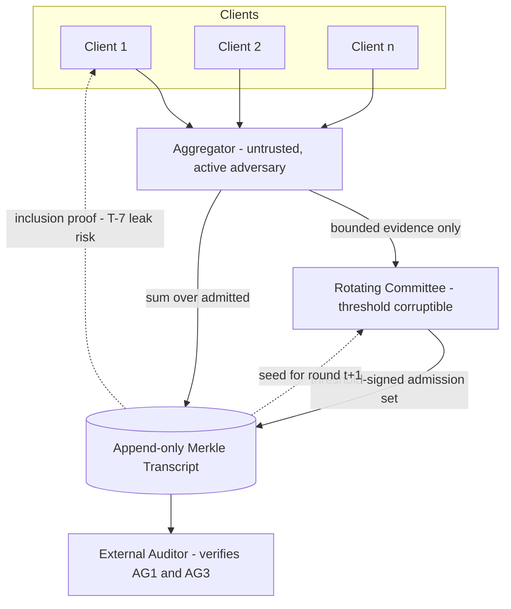

# PROJECT_MASTER_SPEC.md — BC-FL-SRV

**Status:** v0.1 — Session 1, 2026-09-03. Authoritative specification (Section 16).
**Serves:** `RD-001` (locked in `DECISIONS.md`). Everything here exists to test that hypothesis.

---

## 1. Project identity

**BC-FL-SRV** — a federated-learning system whose per-round *admission decisions* are attested by a rotating committee and anchored in an append-only Merkle transcript, so that an external auditor can verify **which clients were admitted and that the declared rule was applied**, without the aggregator ever seeing individual updates.

---

## 2. Research definition

### 2.1 Question

Under secure aggregation, can *correct admission* (AG1) and *non-equivocation* (AG3) be made externally verifiable using only signatures and hashing — no ZK, no TEE — and what does that cost in privacy and in resilience to an adversary aimed at the admission layer?

### 2.2 Hypothesis (falsifiable)

> A rotating committee that co-signs admission decisions into an append-only Merkle transcript makes AG1 and AG3 verifiable by an external auditor under secure aggregation, using only signatures and hashing, at overhead **independent of model size**; and the privacy disclosed to the committee can be **bounded and traded against detection power along a measurable curve**.

### 2.3 Contribution boundary (from `D-004`)

**Primary contribution — exactly one:** a **protocol interaction** — how committee-attested admission interacts with secure-aggregation privacy and with ledger-anchored non-equivocation, including the leak that *an inclusion-proof query is itself a participation disclosure*.
**Secondary:** an evaluation methodology that attacks the accountability layer rather than only the model.
**Not claimed:** any new cryptographic primitive, any new robust-aggregation rule.

### 2.4 Research Gap Statement

See `RD-001`. In summary: verifiable-FL effort concentrates on AG2 (10/13 systems in the PoPETs 2026 SoK); AG1 sits at 2/13 and AG3 at 3/13 despite being the cheapest claims to build (O(K), O(1)); the SoK systematizes only ZKP- and TEE-based instantiations and mentions *committee* twice. The committee-based, ZK-free instantiation under SecAgg is the uncovered point in that design space.

### 2.5 Novelty position

**POTENTIALLY NOVEL in this specific combination and evaluation — REQUIRES FURTHER VALIDATION.** The load-bearing number (AG1 = 2/13 adoption) requires primary-source confirmation before any submission.

### 2.6 Assumptions

| ID | Assumption | Status |
|---|---|---|
| A-1 | Clients hold long-term Ed25519 keypairs; public keys registered before training | design assumption |
| A-2 | Committee corruption bounded by fraction `c` per round | **parameter under test**, not an article of faith |
| A-3 | The sortition seed source is not attacker-controlled | tested by the grinding attack (RC-8) |
| A-4 | Secure aggregation hides individual updates from the **aggregator** | standard SecAgg assumption |
| A-5 | At least one honest auditor reads the transcript | **explicitly switched OFF in IE-4** |

### 2.7 Threats to validity

- **Simulation, not deployment.** All parties run in one process/machine. Network adversaries are modelled, not real.
- **Scale.** CPU-only, 12 cores. Client counts and model size are bounded; generalisation to cross-device scale is **not** claimed.
- **Attacker realism.** Per Shejwalkar et al. (IEEE S&P 2022), high malicious fractions are unrealistic in production FL. Results are reported across a *range* of fractions with the realistic low end foregrounded.
- **Paywalled venues unreachable** from this environment (ACM DL returned HTTP 403). Citations carry a primary-source re-check flag.

### 2.8 Limitations stated up front

- Privacy is **relocated, not preserved absolutely** — a committee above the corruption threshold learns whatever the evidence encodes.
- A ledger provides tamper-**evidence**, not tamper-**prevention**.
- Non-equivocation detection requires auditors to actually compare views; CT's gossip layer was never deployed in practice, and this system does not assume it away.

---

## 3. Goals and non-goals

**Goals.** Externally verifiable AG1+AG3 under SecAgg from cheap primitives; a measured privacy/detection curve; a measured cost curve vs N and K; adversarial evaluation targeting the accountability layer.

**Non-goals.** Solving the privacy–robustness–utility trilemma. Beating state-of-the-art robust aggregation on accuracy. Sybil resistance. Verifiable training. Production deployment. A real blockchain.

---

## 4. Trust model (Section 13) — per actor

Stated as: sees / can modify / can prove / **cannot** prove / trusted for / **explicitly not** trusted for.

### 4.1 Client `C_i`
- **Sees:** global model each round; its own data and update; its own transcript inclusion proof.
- **Can modify:** its own update, arbitrarily (may be malicious).
- **Can prove:** that it submitted a specific commitment in a specific round (signature + context binding).
- **Cannot prove:** that its data is real, that it trained honestly (CL2 is out of scope), or that other clients behaved.
- **Trusted for:** nothing.
- **NOT trusted for:** update honesty, data provenance, participation consistency.

### 4.2 Aggregator `AG`
- **Sees:** masked submissions, the aggregate sum, committee attestations, the transcript.
- **Cannot see:** individual unmasked updates (**A-4**).
- **Can modify:** what it publishes; what it claims was admitted; message routing.
- **Can prove:** that it published a specific root at a specific time.
- **Cannot prove:** that it applied the admission rule honestly — **this is precisely why AG1 must be attested by someone else.**
- **Trusted for:** liveness only.
- **NOT trusted for:** honest admission, honest aggregation, non-equivocation, delivery. Assumed **actively malicious**.

### 4.3 Committee member `M_j`
- **Sees:** the bounded evidence for each submission in its round (`D-003`), plus the transcript.
- **Can modify:** its own attestation; may collude with other members.
- **Can prove:** that it attested a specific admission set for a specific round.
- **Cannot prove:** honesty of its own evidence evaluation beyond what the rule is deterministic on.
- **Trusted for:** correct rule application **only while corruption stays below threshold**.
- **NOT trusted for:** individual honesty; confidentiality of the evidence it sees.

### 4.4 Auditor `AUD`
- **Sees:** the public transcript only.
- **Can prove:** inclusion, consistency, and that an admission set carries a valid threshold attestation.
- **Cannot prove:** that the attested rule application was *semantically* correct if the committee lied in coalition; nor detect equivocation without a second view.
- **Trusted for:** nothing — it is a verifier, and its absence is tested (IE-4).

### 4.5 Mechanism → guarantee table (the Section 13 discipline)

| Mechanism | Provides | Does **NOT** provide |
|---|---|---|
| Merkle transcript | tamper-evidence; inclusion + consistency proofs; ordering | tamper-prevention; protection from equivocation without a second view; any statement about content validity |
| Ed25519 signatures | origin authentication; non-repudiation of a specific statement | truth of the statement signed |
| Threshold committee attestation | soundness of AG1 **while corruption < threshold** | soundness under coalition above threshold; confidentiality from the committee |
| Masked-input SecAgg | hides individual updates **from the aggregator** | robustness; DP; hiding the sum; protection from a malicious *committee* |
| Context binding (round id, prev root) | replay and cross-round reuse rejection | freshness against a colluding aggregator that stalls rounds |

---

## 5. Threat model (Section 14)

| ID | Threat | Precondition | Component | Impact | Mitigation | Detection | Residual risk | Test |
|---|---|---|---|---|---|---|---|---|
| T-1 | **Selective dropping** — AG silently omits an honest client | malicious AG | admission | honest contribution erased | committee attestation of admitted set + client inclusion proof | auditor recomputes admitted set from transcript | client must actually check | RC-8 |
| T-2 | **Split-view / equivocation** — AG shows different roots to different parties | malicious AG | transcript | divergent model histories | root chaining + consistency proofs + cross-view comparison | only on view comparison | **undetectable with a single view** — measured in IE-4 | RC-8 |
| T-3 | **Committee collusion** — coalition attests a false admission set | corruption ≥ threshold | committee | AG1 soundness broken | threshold size vs corruption fraction | none in-band above threshold | **real and stated**; probability curve reported | RC-8 |
| T-4 | **Sortition grinding** — adversary biases committee selection | attacker influence on seed | sortition | raises effective corruption | seed bound to prior transcript root | seed provenance in transcript | partial | RC-8 |
| T-5 | **Slow-drift admission evasion** — malicious update stays inside the rule's bounds | any malicious client | admission rule | poisoning admitted *and attested valid* | none from AG1 — **this is falsification path 4** | requires a stronger rule | **acknowledged; central to the honest result** | RC-8 |
| T-6 | **Replay** — resubmission of a prior round's evidence | any client | submission | duplicate/stale influence | round-context binding | deterministic validation | low | RS-2 |
| T-7 | **Inclusion-query participation leak** — asking "was I admitted?" reveals participation | observer of queries | audit interface | erodes participation hiding | batched/blind inclusion checks (design requirement) | n/a | **novel tension; measured** | RC-6 |
| T-8 | **Evidence over-disclosure** — encoding leaks more than intended | committee sees evidence | evidence encoding | privacy loss | bounded, tunable encoding | leakage measured empirically | **falsification path 3** | RC-3 |

---

## 6. Requirements

### 6.1 Functional

| ID | Requirement | Acceptance criterion |
|---|---|---|
| FR-1 | Transcript is append-only and hash-chained: entry `t` binds the root at `t-1`. | Mutating any historical entry changes the head root; consistency proof old→new fails. |
| FR-2 | Transcript produces an **inclusion proof** verifiable against a root without the full log. | Verifies for present entries; fails for absent/altered. Proof size O(log n). |
| FR-3 | Transcript produces a **consistency proof** between two roots proving append-only extension. | Verifies for genuine extension; fails for reordering, deletion, or in-place edit. |
| FR-4 | Every submission commitment binds **client id, round id, previous root, evidence digest**. | A submission replayed into a different round is deterministically rejected. |
| FR-5 | Committee for round `t` derives from a seed bound to the transcript root at `t-1`. | Any party recomputes the same committee; changing history changes the committee. |
| FR-6 | Admission set attested by ≥ threshold committee signatures over `(round, admitted_digest, rule_id, prev_root)`. | Attestation below threshold is rejected. |
| FR-7 | An auditor with **only** the transcript verifies AG1 and AG3. | Accepts honest runs; rejects every tampered run in the attack suite. |
| FR-8 | Aggregator sums admitted masked inputs and learns no individual update. | Test asserts no plaintext individual update is reachable aggregator-side. |

### 6.2 Non-functional

| ID | Requirement | Target |
|---|---|---|
| NFR-1 | AG3 verification cost **independent of model size N** | measured constant vs N — *a falsification test, not a hope* |
| NFR-2 | AG1 verification cost **O(K)**, independent of N | measured |
| NFR-3 | Transcript storage per round O(K) digests, not O(K·N) | measured |
| NFR-4 | A full configuration completes on 12 CPU cores within a session | enforced by sizing, never by cutting research-critical scope |
| NFR-5 | Every run reproducible from a manifest (seeds, config, versions) | byte-identical metrics on re-run |

---

## 7. Architecture



**Round protocol.**
1. **Submit.** Client masks its update, computes bounded evidence, signs `(client_id, round, prev_root, evidence_digest, masked_digest)`.
2. **Evaluate.** Committee for round `t` (derived from `prev_root`) applies the declared admission rule to the bounded evidence.
3. **Attest.** Committee threshold-signs the admitted-set digest.
4. **Aggregate.** Aggregator sums masked inputs over exactly the attested admitted set.
5. **Finalize.** Submissions, attestation, and aggregate digest appended; new root seeds round `t+1`.
6. **Audit.** Any auditor verifies AG1 (attestation matches recorded rule and set) and AG3 (root chain + consistency).

---

## 8. Data architecture and interface schemas

```
Submission   { client_id, round, prev_root, masked_digest, evidence, sig }
Evidence     { encoding_id, payload }        # bounded per D-003; the tunable knob
AdmissionSet { round, rule_id, admitted[], rejected[], prev_root, digest }
Attestation  { round, admitted_digest, signers[], sigs[] }   # threshold-checked
Entry        { seq, kind, payload_digest, prev_root }        # kind: SUBMIT|ADMIT|AGGREGATE|FINALIZE
Root         { seq, root_hash }
```

Hashing: SHA-256 over canonical, length-prefixed encodings, with **domain separation per entry kind** (prevents cross-type confusion).

---

## 9. Failure and reliability behaviour

Client dropout mid-round → excluded and recorded explicitly, so dropout is **distinguishable from selective dropping**. Committee below threshold → round aborts and is recorded as aborted, never silently finalized. Malformed submission → deterministic rejection with recorded reason. **Every rejection is recorded**, because an unrecorded rejection is indistinguishable from selective dropping.

---

## 10. Experimental program

| Exp | Question | Varies | Measures | Falsifies |
|---|---|---|---|---|
| E-1 | Is verification cost independent of N? | model size N, client count K | verify time, proof size, transcript bytes | path 2 |
| E-2 | Does AG1+AG3 detect accountability attacks? | T-1, T-2, T-4 toggles | detection rate, false positives | path 1 |
| E-3 | What does committee corruption cost? | corruption fraction, committee size, threshold | AG1 failure rate vs analytic prediction | path 1 |
| E-4 | Privacy/detection curve | evidence disclosure level | leakage metric vs detection power | path 3 |
| E-5 | Slow-drift evasion | attacker drift rate under the rule | admitted-attack rate, model damage | path 4 |
| E-6 | Auditors absent | IE-4 toggle | what remains detectable with zero auditors | honesty of the AG3 claim |
| E-7 | Ablations | remove ledger / committee / SecAgg individually | contribution of each component | over-claiming |

**Baselines:** no-ledger (signed log only), no-committee (aggregator self-attests), plaintext-admission (no SecAgg), no-verification FL.

---

## 11. Reproducibility plan

Fixed seeds per run; a manifest recording config, seeds, resolved package versions, git commit; deterministic partitioning; scripted entry points; results written alongside their manifest. **No undocumented manual steps.**

---

## 12. Feature status ledger

| ID | Feature | Status |
|---|---|---|
| RC-1 | Merkle transcript + typed hash-chained Transcript | **IMPLEMENTED** — 162 tests, 100% coverage |
| RC-2..RC-9 | committee, evidence, rule, attestation, auditor, SecAgg, attacks, measurement | `PROPOSED` |
| RS-1..RS-7 | identity, binding, FL loop, partitioner, seeding, config, logging | `PROPOSED` |

**Nothing above is `IMPLEMENTED` until code exists, tests exist, and tests have run.**
