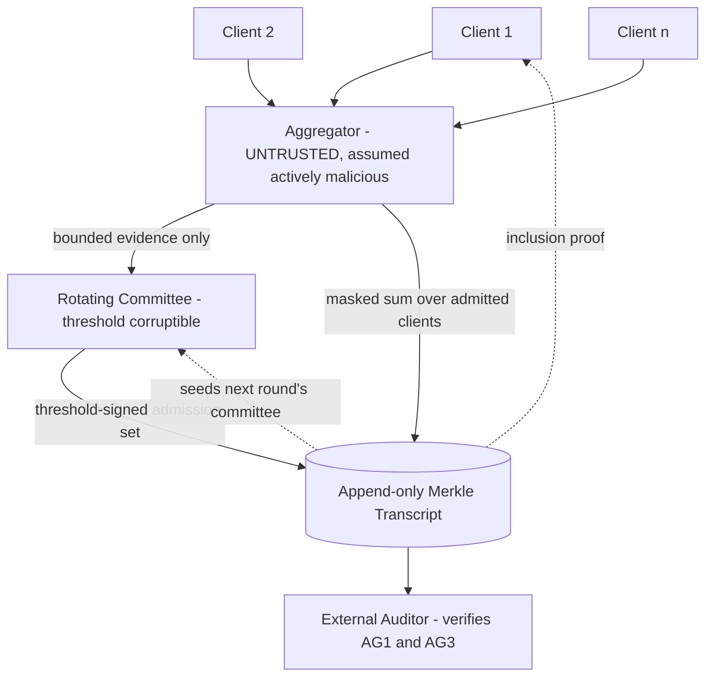
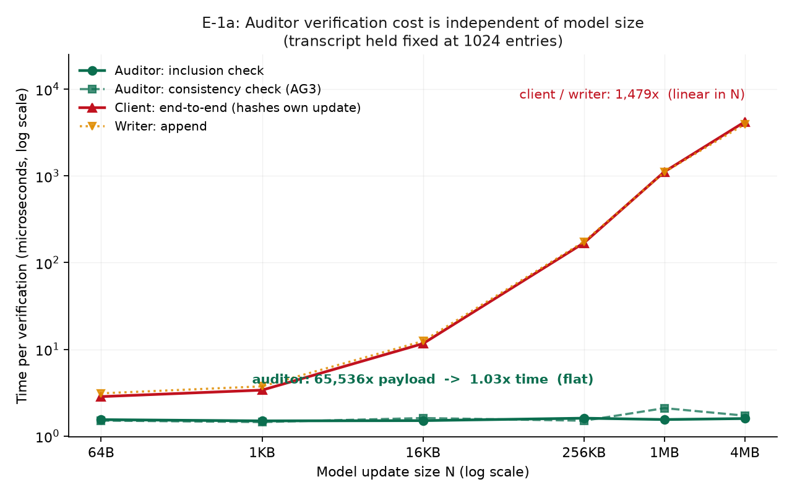
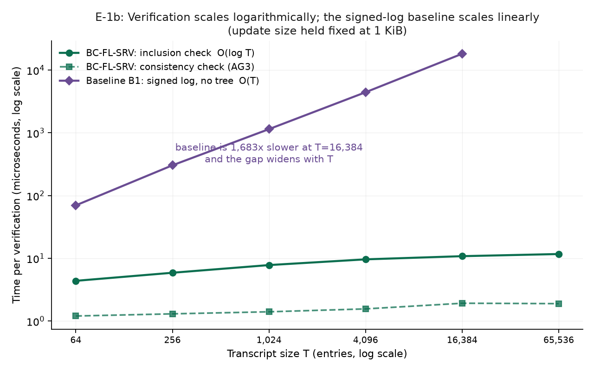
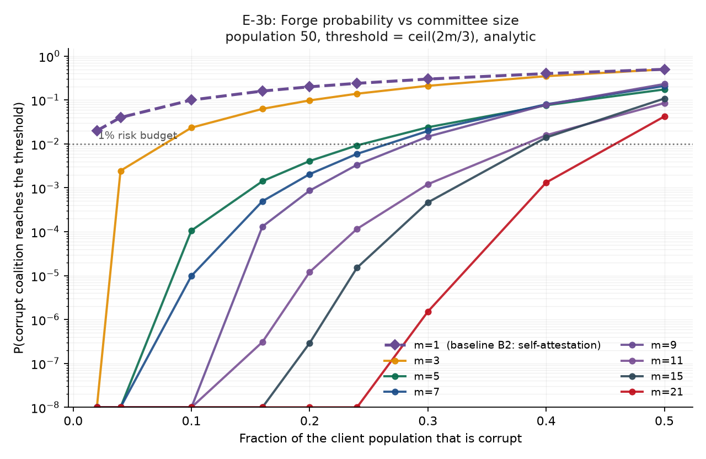
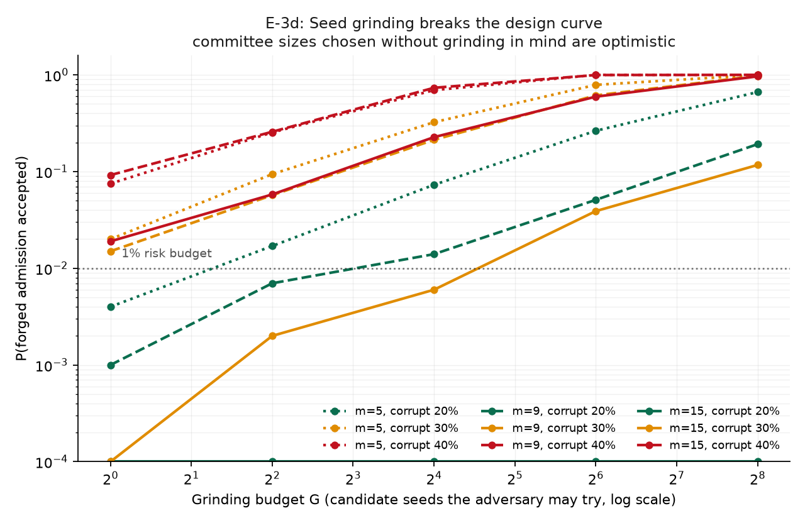

# BC-FL-SRV — Verifiable Admission Decisions for Federated Learning

> In federated learning with secure aggregation, the server deliberately **cannot see individual client updates**. That creates an accountability hole: when the server says *"I admitted these 40 clients and rejected these 10"*, nobody can check whether that is true. It could be silently dropping honest clients, or waving through bad ones.
>
> **BC-FL-SRV makes that admission decision verifiable.** A rotating committee independently checks it and co-signs the result into an append-only Merkle transcript, so any outsider can later verify exactly which clients were admitted and that the declared rule was followed — without ever seeing anyone's update.

---

## The problem, and why existing work doesn't close it

Verifiable-FL research concentrates almost entirely on **aggregation correctness** — proving the server combined the updates it claims to have combined. The most recent systematization of the field¹ surveys 13 systems and finds:

| Integrity claim | Systems covering it | Cost | Ease of implementation |
|---|---|---|---|
| **AG2** correct aggregation | **10 / 13** | O(K·N) | 2 / 5 |
| **AG1** correct *admission* | **2 / 13** | O(K) | 4.5 / 5 |
| **AG3** non-equivocation | **3 / 13** | O(1) | 5 / 5 |

The least-studied claims are also the **cheapest to build**. And that SoK explicitly argues that cheap signature-based schemes *"cannot extend to AG1, since there is no mechanism to bind the aggregation output to a declared admission set."*

**This project supplies that missing binding** — using only signatures and hashing. No zero-knowledge proofs, no trusted hardware.

<sub>¹ Rizzini, Esposito, Gagliardoni, Bruschi. "SoK: Verifiable Integrity Claims for Privacy-Preserving Federated Learning." *PoPETs* 2026(4):248–271. Full citation list with per-source evidence tags in [`research/RELATED_WORK.md`](research/RELATED_WORK.md).</sub>

---

## Architecture



**Round protocol.** Clients mask their updates and disclose *bounded evidence* → the round's committee, derived from the previous transcript root, applies a declared admission rule → members threshold-sign the admitted set → the aggregator sums only admitted updates → everything is appended to the transcript, whose new root seeds the next committee.

**Why the ledger is load-bearing, not decorative:** AG3 (non-equivocation) is *defined* by the append-only transcript. Remove the ledger and the claim ceases to exist.

---

## Results

All numbers below were measured on this machine (12 CPU cores, no GPU) and are reproducible from the commands in [Reproducing the results](#reproducing-the-results). Every experiment writes a manifest recording the git commit, dirty flag, package versions, seeds, and parameters.

### Verification is cheap, and independent of model size



| | 64 B update | 4 MiB update | Ratio |
|---|---|---|---|
| **Auditor — inclusion check** | 1.55 µs | 1.59 µs | **1.03×** |
| **Auditor — non-equivocation check** | 1.51 µs | 1.72 µs | **1.14×** |
| Client — end-to-end (hashes its own update) | 2.85 µs | 4219 µs | 1,479× |

A **65,536× larger model costs the auditor 3% more time.** The client and writer costs *do* grow with N and are reported for exactly that reason — the claim is about the auditor.

### …and logarithmic in transcript size, unlike the obvious alternative



`inclusion_µs = 0.761 × log₂(T)`, **R² = 0.985**. A signed log with no Merkle tree is **1,683× slower at T = 16,384** and must transfer the whole log (16 MB) instead of a 448-byte proof.

### The auditor catches what it claims to catch

| | Attacks detected | False positives |
|---|---|---|
| **BC-FL-SRV** | **12 / 14** | 0 / 50 honest rounds |
| B1 — signed log, no tree | 5 / 14 | — |
| B2 — aggregator self-attests | 6 / 14 | — |

The row that justifies the whole design is **"dishonest rejection (aggregator alone)"**: excluding an honest client for no reason requires 6 of 9 committee co-signatures here, but under self-attestation it requires nothing and leaves no trace.

**Two attacks are undetected by design and reported as rows, not omitted:** selective dropping seen by a public auditor (only the affected *client* can detect it), and split-view with a single observer (needs two views to compare).

### Committee corruption is quantifiable — and we found a weakness in our own design



The empirical sortition matched the hypergeometric model in **30/30 cells within 3σ**. At 20% corruption, self-attestation forges with probability 0.20 — exactly the corruption fraction — while a committee of 15 gives 2.92×10⁻⁷.

Then E-3d broke it:



The aggregator controls transcript entry ordering, so it can try candidate histories **offline** and publish only the one yielding the most corrupt committee. Free, invisible, and it amplified forge probability **192×** with 256 attempts.

**Fixed** ([`D-011`](DECISIONS.md)) by seeding each committee from the *previous round's attestation signatures*, which the aggregator cannot forge — collapsing the grinding budget to one attempt when the prior committee was honest. **Not fully fixed:** an aggregator that already compromised the previous round can still grind, and this is not a VRF. Both stated rather than papered over.

### Does the rule being recorded actually work?

This is the question the project exists to answer honestly, and it took two generations of rule to answer it.

**The central result — the mechanism costs nothing in ML terms.** Across two independent rules and every attack tested, the full committee-backed verifiable system produces results **identical to machine precision** to the same rule applied by a trusted server:

| Attack | Rule alone (trusted server) | + full verifiable mechanism | Difference |
|---|---|---|---|
| sign-flip | 0.7361 | 0.7361 | **0.0e+00** |
| label-flip | 0.7519 | 0.7519 | **0.0e+00** |

Same accuracy, same detection rate, differing only by **~2 KB of transcript per round**. **Verifiable admission is rule-agnostic: it imposes no ML cost and constrains no rule.** Any accountability layer claiming to *improve* robustness should be asked to show this comparison.

**First-generation rule (G1) — the honest negative.** A slow-drift attacker that deliberately sits inside the admission threshold was admitted **85–89% of the time**, and no disclosure level stopped it — not even full plaintext (TPR 0.33). This was **pre-registered as the expected outcome** before the experiment ran, and the attacker was never weakened. [Full findings →](results/E4_E5_FINDINGS.md)

**Second-generation rule (G2) — a diagnosed fix, and a qualified improvement.** The failure had a locatable cause: *L2 distance-to-median conflates magnitude with direction*, so an attacker shrinking its update to duck the norm bound also moves **closer** to the median — the rule paid it twice for one move. G2 tests magnitude and direction independently, on the same 64-dim sketch and with no extra disclosure.

| Attack | G1 | G2 | Δ |
|---|---|---|---|
| **sign-flip** | 0.33 | **0.61** | **+0.28** |
| noise | 0.23 | 0.34 | +0.11 |
| **slow-drift** | 0.32 | **0.43** | +0.11 |
| label-flip | 0.93 | 0.87 | −0.06 |
| false-positive rate | 0.12 | **0.10** | better |

**Verdict: B — qualified.** G2 is strictly better than G1 at *every* attacker magnitude below the threshold, and lifts sign-flip accuracy by 5 points. It does **not** reach the pre-registered bar of TPR ≥ 0.80, and on slow drift specifically the +0.11 gain falls inside the range my own criteria called a *negative* result. Both readings are reported. [Full findings →](results/G2_FINDINGS.md)

**Three of eight pre-registered predictions failed** — including the one that mattered most to me. A warm-up ablation refuted my hypothesis that cross-round accumulation drove the gain: longer warm-up made detection *worse* (0.42 → 0.30). The improvement came from the within-round directional test instead. The per-client reputation scores do separate cleanly (AUC 1.000 after 3 rounds), but the pre-registered `median − 3·MAD` cutoff is too lenient to fire on that separation. **The bottleneck is the threshold, not the signal** — recorded as a limitation with a specific testable fix rather than tuned away after the fact.

**A published attack broke the design mid-project.** A prior-art check found that a fixed, publicly-known sketch lets an adversary hide in its null space — a perturbation at 90% of the honest norm produced a sketch difference of **5.6 × 10⁻¹⁵**, numerically invisible. The fix, *commit-then-sketch*, derives the projection seed from the round's commitments, which the transcript already records (TPR 0.35 → 0.44). **This is the second place the ledger does real cryptographic work**, alongside carrying the auditable reputation.

## What this project does NOT claim

Stated up front, because a well-demonstrated limitation is worth more than an exaggerated claim.

- **This is not production secure aggregation.** It implements *simplified additive masking with no dropout recovery*, providing **statistical** rather than information-theoretic hiding. No key agreement, no secret sharing, no malicious-server hardening.
- **The sortition is not a VRF.** It gives recomputability and history-binding, not unpredictability against a party with transcript discretion.
- **Fashion-MNIST is a controlled environment**, not evidence about real-world FL security.
- **No Sybil resistance.** The SoK is explicit that AG1 provides none without external trust anchors, and this project adds none.
- **Adaptive corruption is not modelled.** An adversary who bribes committee members *after* seeing the selection defeats any committee size.
- **Simulation in one process.** No network adversary, no timing attacks.
- **Novelty is claimed narrowly:** this design point is not covered by the most recent systematization of verifiable FL, and that systematization argues cheap primitives cannot reach AG1. We do **not** claim nobody has ever done this.

---

## Decentralized Federated Learning Demonstration

BC-FL-SRV includes an end-to-end single-command demonstration of **Blockchain-Based Decentralized Federated Learning**:

```bash
# Single-command run (cross-platform)
python scripts/run_demo.py

# Or customize parameters:
python scripts/run_demo.py --clients 5 --rounds 10 --alpha 0.5
```

### What this demonstrates:
1. **Multiple FL Clients**: Deterministic Ed25519 cryptographic identities (`bcflsrv.crypto.identity`) holding non-IID shards (Dirichlet partition of Fashion-MNIST).
2. **Local Model Training**: Each client trains on its local data shard and produces a model delta update.
3. **Cryptographic Binding & Signatures**: Clients compute SHA-256 commitments `H(domain || client_id || round || delta)` and sign with their private keys.
4. **Verification Security Layer**: Verifies client registry membership, round freshness, signatures, and commitment integrity before any update is accepted.
5. **Distributed Blockchain Ledger**: Multi-node ledger (replicated across 3 nodes with quorum consensus) that records `ROUND_START`, `UPDATE_SUBMIT` (with commitments and verification statuses), `AGGREGATION` (with global model commitment & test accuracy), and `ROUND_END` blocks.
6. **Secure Aggregation**: Only verified, accepted updates are aggregated via FedAvg into the new global model.
7. **Live Tampering Demonstration**: Demonstrates defense against three realistic attacks:
   - **Update Tampering (byte flip)**: Rejected at commitment verification.
   - **Commitment Forgery**: Rejected at signature verification.
   - **Identity Spoofing**: Rejected at registry check.
8. **Automated Visualizations**: Outputs a combined dashboard and individual plots for test accuracy, loss, client participation, and blockchain block timelines.

Results and figures are written cleanly to `results/demo_decentralized_fl/`:
- `blockchain.jsonl`: Complete replicated blockchain ledger.
- `summary.json` & `rounds.json`: Metrics and tampering detection report.
- `figures/dashboard.png`: High-resolution summary dashboard.
- `final_model.npy`: Final trained model parameters.

*(Existing research experiments E1–E5, G2, G3 and their artifacts in `results/` are fully preserved).*

---

## Setup

Requires Python 3.13 and ~2 GB disk. Everything stays inside this directory; nothing is installed globally.

```bash
python -m venv --system-site-packages .venv
.venv/Scripts/python.exe -m pip install -r requirements.txt
.venv/Scripts/python.exe -m pytest tests/ -q
```

`--system-site-packages` lets the venv *read* an existing torch/numpy install rather than re-downloading ~2 GB; new packages are still written only into `.venv`.

## Reproducing the results

```bash
.venv/Scripts/python.exe scripts/exp_e1_verification_cost.py
.venv/Scripts/python.exe scripts/plot_e1.py
.venv/Scripts/python.exe scripts/exp_e2_tamper_detection.py
.venv/Scripts/python.exe scripts/exp_e3_committee_corruption.py
.venv/Scripts/python.exe scripts/plot_e3.py
.venv/Scripts/python.exe scripts/exp_e4_e5.py --workers 3
```

Fashion-MNIST downloads automatically on first use and is **SHA-256 verified** against pinned checksums. Runtimes on 12 CPU cores: E-1 ≈ 2 min, E-2 < 1 min, E-3 ≈ 5 min, E-4/E-5 ≈ 80 min.

Each run writes `results/runs/<id>/manifest.json` with the git commit, **working-tree dirty flag**, resolved package versions, seeds and parameters. A result produced from uncommitted code is flagged as such rather than silently recorded as reproducible.

## Interactive Research Dashboard & UI Platform

The platform includes a real-time, zero-dependency web interface for live federated learning demonstrations, blockchain exploration, and client transparency:

```bash
# Launch the interactive research dashboard (default port 8000)
.venv_mac/bin/python scripts/run_demo.py --ui --port 8000

# Or execute standalone automated pipeline with optimal convergence
.venv_mac/bin/python scripts/run_demo.py --clients 5 --rounds 10 --alpha 0.5 --epochs 2 --max-batches 40 --lr 0.03
```

- **Pure Canvas 2D Visual Engine:** Custom high-DPI scaled charting engine with zero visual clipping, dynamic label spacing, interactive crosshair tooltips, and high-resolution modal inspection view.
- **Genuine Convergence Benchmark:** Reaches **83.88% test accuracy** on Fashion-MNIST under Non-IID Dirichlet partitioning ($\alpha=0.5$), approaching the theoretical centralized ceiling (~86–89%) for SmallCNN.
- **Client Weights & Gradient Transparency:** Full visibility into client parameter update L2 norms ($||\Delta w_i||$), min/max/mean/std statistics, per-layer breakdowns (`conv1`, `conv2`, `fc1`, `fc2`), consensus alignment score ($\cos(\Delta w_i, \Delta w_{\text{global}})$), and signed cryptographic commitments.
- **Blockchain Uploads Explorer:** Granular ledger transaction feed recording every model update upload with payload byte sizes, SHA-256 parameter commitments, and quorum validation.
- **Live Security Attack Demonstrations:** In-browser verification of Byzantine defense layers (commitment tampering, unauthorized client identity spoofing, and historical block tampering).

## Repository layout

```
src/bcflsrv/
  ledger/      RFC 6962 Merkle tree + typed hash-chained transcript
  crypto/      Ed25519 identities, verifiable committee sortition
  protocol/    admission sets, threshold attestation, external auditor
  fl/          Fashion-MNIST, model, evidence ladder, admission rules, attacks, masking
  bench/       timing harness, run manifests, comparison baselines
  demo/        decentralized FL runner, pipeline orchestrator, client models
  ui/          FastAPI backend, vanilla CSS/JS dashboard, high-DPI canvas charts
scripts/       experiment runners, demo runner, and plotting utilities
tests/         366 tests (unit, protocol, security, and UI integration)
results/       findings write-ups, figures, summary tables, demo artifacts
```

**Key documents:** [`DECISIONS.md`](DECISIONS.md) — every locked decision with alternatives and rationale · [`PROJECT_MASTER_SPEC.md`](PROJECT_MASTER_SPEC.md) — trust model, threat model, requirements · [`EVALUATION_PLAN.md`](EVALUATION_PLAN.md) — what each experiment proves or disproves · [`research/RELATED_WORK.md`](research/RELATED_WORK.md) — cited prior art with evidence tags.

## Engineering notes

- **366 tests, 99% line coverage** on the core package. Security-relevant code is tested adversarially: every tampering, forgery, replay, malformed-input, and blockchain corruption case asserts *failure*, because a proof system tested only on honest inputs has not been tested.
- **Verifiers fail closed and never raise** on attacker-supplied bytes — a crash in an auditor is a denial of service on audit.
- **The naive Merkle implementation is retained as a test oracle** for the O(log n) fast path (825× faster at n=8000), so an optimisation bug cannot silently corrupt every downstream result.
- **Reproducibility is enforced, not assumed:** manifests, pinned dataset checksums, deterministic seeded identities and partitions, and figures regenerated from committed CSVs rather than from memory.
