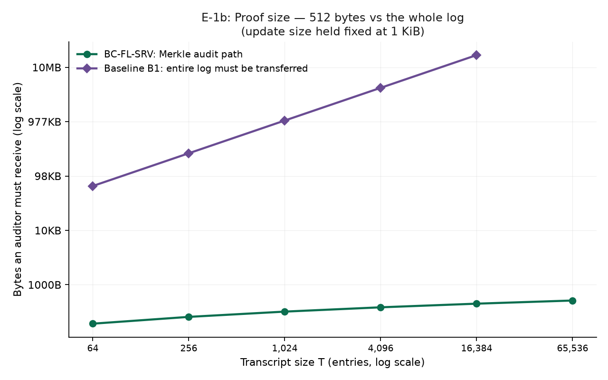

# E-1 Findings — Verification Cost Scaling

**Experiment:** E-1 (`scripts/exp_e1_verification_cost.py`)
**Tests:** sub-claim **C2** — *"verification cost is independent of model size N"*
**Date:** 2026-09-04 · **Hardware:** 12 logical cores, CPU-only, no GPU · Python 3.13.3, Windows 11
**Reproduce:** `.venv/Scripts/python.exe scripts/exp_e1_verification_cost.py` then `scripts/plot_e1.py`
**Provenance:** full manifest (git SHA, dirty flag, package versions, seeds, parameters) in `results/runs/e1_*/manifest.json`

Status tags: `LIT` literature · `HYP` hypothesis · `IMPL` implemented · `RESULT` measured here.

---

## 1. What was measured, and why it is split four ways

"Verification cost" is not one number. Reporting a single figure would have been either flattering or damning depending on which one was chosen, so four distinct costs were measured separately:

| Cost | Who pays it | Touches the update payload? |
|---|---|---|
| **Auditor — inclusion check** | external auditor | **No.** Operates on a leaf hash and ~log₂T sibling hashes. |
| **Auditor — consistency check (AG3)** | external auditor | **No.** Operates on two roots and a proof. |
| **Client — end-to-end** | a client checking its own entry | **Yes.** It must hash its own update first. |
| **Writer — append** | the log operator | **Yes.** |

The research claim concerns the auditor. The client and writer costs are reported **because they are the ones that do depend on N** — omitting them would have overstated the result.

---

## 2. Results

### 2.1 E-1a — cost vs model size N (transcript fixed at 1024 entries) `RESULT`

Payload swept **64 B → 4 MiB (65,536×)**:

| Cost | 64 B | 4 MiB | Ratio |
|---|---|---|---|
| **Auditor — inclusion** | 1.55 µs | 1.59 µs | **1.03×** |
| **Auditor — consistency (AG3)** | 1.51 µs | 1.72 µs | **1.14×** |
| Client — end-to-end | 2.85 µs | 4219.00 µs | 1,479× |
| Writer — append | 3.11 µs | 3963.43 µs | 1,274× |

Across the whole sweep the auditor inclusion time varied between **1.50 µs and 1.61 µs — a 7.4 % spread**, which is within timing noise on this machine.

### 2.2 E-1b — cost vs transcript size T (update fixed at 1 KiB) `RESULT`

| T | proof nodes | inclusion (µs) | µs per node | Baseline B1 (µs) | B1 / ours |
|---|---|---|---|---|---|
| 64 | 6 | 4.38 | 0.730 | 69.9 | 16× |
| 256 | 8 | 5.89 | 0.736 | 303.8 | 52× |
| 1,024 | 10 | 7.81 | 0.781 | 1,146.5 | 147× |
| 4,096 | 12 | 9.63 | 0.803 | 4,437.5 | 461× |
| 16,384 | 14 | 10.82 | 0.773 | 18,211.3 | **1,683×** |
| 65,536 | 16 | 11.71 | 0.732 | *(not run — see §4)* | — |

Cost per proof node is essentially constant (0.73–0.80 µs), and a least-squares fit gives

> **inclusion_µs = 0.761 × log₂(T)**, with **R² = 0.985**

A **1,024× increase in transcript size costs 2.7× more verification time.** Proof size grows from 192 B to 512 B.

### 2.3 E-1c — storage per round `RESULT`

The transcript records a **32-byte digest** per submission, not the update. For 10 clients with 400 KB updates: **2,031 B/round** versus 4,000,000 B if updates were logged — a **1,969× reduction**. This confirms **NFR-3** (transcript is O(K) digests, not O(K·N)).

---

## 3. What this demonstrates

1. **C2 is supported for the auditor.** `RESULT` Auditor verification is independent of model size across 65,536× — 1.03× time for 65,536× payload. This is the load-bearing measurement: it means an auditor can verify admission decisions for a 4 MiB model as cheaply as for a 64 B one.
2. **Verification is logarithmic in transcript size.** `RESULT` R² = 0.985 against log₂(T) is a strong fit, and constant per-node cost explains *why*: the work is exactly one hash per proof node.
3. **The Merkle tree earns its place over a signed log.** `RESULT` This answers the obvious "why not just sign the log?" objection with data: B1 is **1,683× slower at T=16,384** and the gap grows linearly. It must also transfer the entire log (16 MB) versus a 448-byte proof.
4. **The SoK's O(1)/O(K) prediction is consistent with measurement.** `LIT` predicted AG3 at O(1) and AG1 at O(K); the AG3 consistency check measured 1.2–1.9 µs essentially flat in both N and T.

---

## 4. What this does NOT demonstrate — read before citing

This section exists so the result is not over-claimed.

1. **It does not test AG1 at all.** E-1 measures *transcript* verification. Committee attestation and admission-set verification are not implemented yet (T-C4/T-D2), so the **O(K) prediction for AG1 is still `HYP`, not `RESULT`**.
2. **It says nothing about security.** These are timing measurements on honest inputs. Whether tampering is *detected* is E-2; whether a colluding committee can forge an admission set is E-3. **Fast verification of a worthless claim is still worthless.**
3. **Client cost genuinely grows with N.** `RESULT` A client hashing a 4 MiB update pays ~4.2 ms. That is negligible beside training the update, but the claim is specifically about the **auditor**, and any statement that "BC-FL-SRV verification is independent of model size" without that qualifier is wrong.
4. **Single machine, single configuration.** No cross-platform or cross-hardware validation. The *shape* of the scaling should transfer; absolute microsecond figures will not.
5. **Python implementation.** Constants are interpreter-bound and would shrink substantially in a compiled language. Only ratios and asymptotics should be quoted.
6. **B1 was capped at T = 16,384.** Its O(T) verification made larger sizes impractically slow to benchmark repeatedly — which is itself the finding, but it means the T = 65,536 comparison is **extrapolated, not measured**, and is reported as absent rather than estimated.
7. **Proof generation is O(T) in the current implementation.** Only *verification* is logarithmic. The log operator can generate proofs more cheaply with a cached tree; that has not been implemented because no experiment requires it.

---

## 5. Effect on the research hypothesis

| Sub-claim | Before | After | Basis |
|---|---|---|---|
| **C2** — verification independent of N | `HYP` | **supported for the auditor** `RESULT` | 1.03× time for 65,536× payload |
| **C1** — tampering is detectable | `HYP` | unchanged | E-2 not yet run |
| **C3** — soundness degrades predictably | `HYP` | partially supported | empirical sortition matches the hypergeometric model (unit-tested) |
| **C4** — disclosure buys detection | `HYP` | unchanged | E-4 needs the evidence ladder |
| **C5** — stops a slow-drift attacker | `HYP` (predicted **false**) | unchanged | E-5 needs the FL loop |

**Net:** the *cheapness* half of RD-001 is now evidence-backed. The *usefulness* half — that what is being verified is worth verifying — is entirely untested. E-2 is the next thing that matters, and it is a security experiment, not a performance one.

**An honest framing for the report:** E-1 shows the mechanism is cheap enough to be practical, and cheaper than the obvious alternative by three orders of magnitude at realistic transcript sizes. It does not yet show the mechanism is *useful*. Those are separate claims and only the first has evidence.

---

## 6. Unexpected finding — an implementation result worth keeping

Building the transcript was initially **O(T²)** because the root was rebuilt on every append. At T = 10⁵ that is ~10¹⁰ hash operations and the experiment simply would not run. Adding an incremental tree-head (standard RFC 6962 subtree-stack) reduced append to O(log T):

| Entries | Naive rebuild | Incremental | Speedup |
|---|---|---|---|
| 500 | 0.136 s | 0.002 s | 72× |
| 2,000 | 2.169 s | 0.010 s | 216× |
| 8,000 | 34.781 s | 0.042 s | **825×** |

The growing ratio confirms O(T²) → O(T log T). The naive implementation was **kept as a test oracle**: a property test asserts both produce identical roots for every size 1–130 and at power-of-two boundaries, so an optimisation bug cannot silently corrupt every downstream result. `IMPL`
