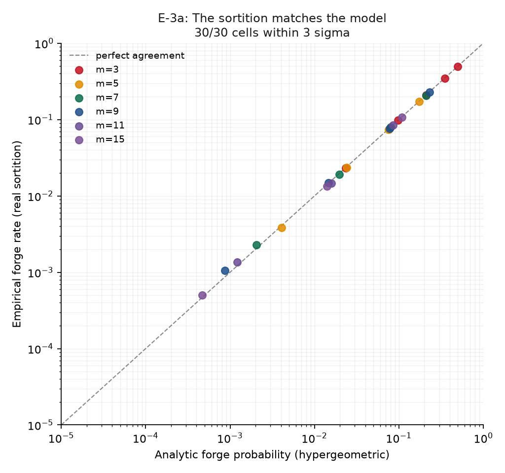

# E-3 Findings — Committee Corruption and Seed Grinding

**Experiment:** E-3 (`scripts/exp_e3_committee_corruption.py`)
**Tests:** sub-claim **C3** — *"soundness degrades predictably and quantifiably with committee corruption"*
**Date:** 2026-09-04 · Population 50, threshold rule ⌈2m/3⌉ · 20,000 trials per cell (E-3a)
**Reproduce:** `.venv/Scripts/python.exe scripts/exp_e3_committee_corruption.py` then `scripts/plot_e3.py`

Status tags: `LIT` literature · `HYP` hypothesis · `IMPL` implemented · `RESULT` measured here.

> **Headline: E-3 found a real weakness in our own design.** Sub-experiment E-3d showed that an adversary able to *grind* the sortition seed amplifies its forge probability by up to ~192×. This is reported first, not buried, and it forced a design change (`D-011`).

---

## 1. Assumptions — every number below is conditional on these

The hypergeometric model is exact **only** under A1–A6. This matters because a probability quoted without its assumptions reads like a security guarantee when it is not one.

| | Assumption | Status |
|---|---|---|
| **A1** | The sortition seed is not adversarially chosen | **VIOLATED in E-3d — deliberately** |
| **A2** | Static corruption: the corrupt set is fixed *before* selection | assumed; an **adaptive** adversary who bribes whoever is selected defeats any committee size |
| **A3** | Uniform sampling without replacement from a fixed population | this is *why* the count is hypergeometric rather than binomial |
| **A4** | Every corrupt member selected signs; honest members never sign a false set | assumed |
| **A5** | No Sybil identities | `LIT` The SoK states AG1 gives **no** Sybil resistance without external trust anchors. Inflating the corrupt fraction with fake identities is strictly easier than any attack modelled here. |
| **A6** | Committee membership is observable to the adversary | assumed (conservative) |

**Cryptographic soundness vs practical security.** Under A1–A6 the forge probability is a statement about *any* adversary in the model — a soundness-style claim. Outside them — adaptive corruption, Sybils, seed manipulation — it is **not** a security guarantee. E-3d exists precisely to show how far outside the model reality can sit.

---

## 2. E-3a — the model is validated `RESULT`

30 cells (committee sizes 3–15 × corruption 10–50%), 20,000 trials each, using the **real** `select_committee` rather than an idealised sampler.

**30/30 cells fell within 3σ of the hypergeometric prediction; largest absolute deviation 0.0079.**

This validates two things at once: the analytic model is the right one, and the sampler is unbiased. The second matters — a modulo-biased sampler would have produced a systematic gap that looked like a protocol finding rather than a bug.

---

## 3. E-3b — the design curve `RESULT`

Forge probability at threshold ⌈2m/3⌉, population 50:

| Corrupt | m=1 (**B2 self-attest**) | m=5 | m=9 | m=15 |
|---|---|---|---|---|
| 10% | 1.0×10⁻¹ | 1.07×10⁻⁴ | ~0 | ~0 |
| 20% | 2.0×10⁻¹ | 4.08×10⁻³ | 8.66×10⁻⁴ | 2.92×10⁻⁷ |
| 30% | 3.0×10⁻¹ | 2.40×10⁻² | 1.47×10⁻² | 4.66×10⁻⁴ |

**The baseline comparison is stark.** With self-attestation (m=1), forge probability *equals the corruption fraction* — 20% corrupt means a 20% chance the attester is corrupt, and then the record is whatever they say. A committee of 15 at the same corruption gives **2.92×10⁻⁷**, roughly **685,000× lower**. This is the quantitative version of E-2's "dishonest rejection" row.

`smallest_safe_committee()` turns this into a design tool: sizing becomes a *choice* against a stated corruption assumption and risk budget, not a guess.

---

## 4. E-3c — rotation is NOT a clean win `RESULT`

Rotating (fresh committee each round) vs fixed (one committee for all 50 rounds), 1,000 trials:

| m | Corrupt | P(any round forged) rot. | fixed | mean fraction forged rot. | fixed |
|---|---|---|---|---|---|
| 5 | 20% | **0.185** | 0.011 | 0.004 | 0.011 |
| 9 | 20% | **0.049** | 0.003 | 0.001 | 0.003 |
| 9 | 40% | **0.984** | 0.079 | 0.078 | 0.079 |
| 15 | 40% | **0.511** | 0.014 | 0.014 | 0.014 |

**Rotation makes "at least one round forged" dramatically *worse*** — 0.984 vs 0.079 at m=9, 40% corrupt — because it gives the adversary an independent chance every round. It marginally improves the *mean fraction* of rounds forged, since a captured fixed committee owns everything.

**Interpretation.** Rotation trades a low-probability catastrophic outcome for a higher-probability bounded one. Which is preferable depends on whether a single forged round is tolerable. **We do not claim rotation is a security improvement**; the honest statement is that it changes the shape of the risk. Had we reported only the mean-fraction metric, rotation would have looked like a free win.

---

## 5. E-3d — the weakness: seed grinding `RESULT`

Our sortition is recomputable and history-bound but is **not a VRF**. The seed was the previous transcript root, and the aggregator has freedom over what enters the transcript — entry ordering above all. It can therefore try many candidate histories *offline* and publish only the one yielding the most corrupt committee. Each attempt is free and the published result looks like a perfectly ordinary transcript.

| m | Corrupt | G=1 | G=4 | G=16 | G=64 | G=256 | amplification |
|---|---|---|---|---|---|---|---|
| 5 | 20% | 0.0040 | 0.0170 | 0.0730 | 0.2640 | 0.6640 | **166×** |
| 9 | 20% | 0.0010 | 0.0070 | 0.0140 | 0.0510 | 0.1920 | **192×** |
| 9 | 30% | 0.0150 | 0.0570 | 0.2130 | 0.6130 | 0.9780 | 65× |
| 15 | 20% | 0.0000 | 0.0000 | 0.0000 | 0.0000 | **0.0000** | none |
| 15 | 40% | 0.0190 | 0.0580 | 0.2270 | 0.5950 | 0.9650 | 51× |

**Two findings, both important:**

1. **Grinding materially breaks the design curve.** A committee of 9 sized from §3 for a 1% risk budget at 20% corruption is blown past with only ~64 attempts. Any committee size chosen without grinding in mind is optimistic.
2. **Larger committees resist it.** m=15 at 20% corruption stayed at **0.0000 across all budgets up to 256**. Grinding raises the required committee size; it does not automatically defeat the mechanism.

---

## 6. What we changed as a result — `D-011` `IMPL`

Rather than merely sizing around the problem, the seed derivation was changed. The committee for round *t* is now seeded by the previous root **plus a digest of round t−1's committee attestation signatures**.

**Why this helps.** The aggregator cannot forge signatures. To vary the seed it must get the previous committee to sign a *different* admission set. If that committee was honest there is exactly one signature set, so **the grinding budget collapses to G=1** — the leftmost column of the table above.

**What it does not fix, stated plainly:**
- An aggregator that has **already** compromised round t−1 can grind round t. The mitigation raises the cost of the first compromise; it does not help afterwards.
- Dropping a client still perturbs the seed. That is a *detectable* lever (E-2 row 12) but not a prevented one.
- **This is still not a VRF.** Full unpredictability needs a verifiable random function or an external randomness beacon. That is named as future work, not claimed as done.

Signature order is sorted before hashing, because signature ordering would otherwise hand back part of the very lever being removed.

**Regression check:** after the change, E-2 still detects 12/14 with 0 false positives over 50 honest rounds, and all 292 tests pass.

---

## 7. Effect on the research hypothesis

| Sub-claim | Before | After E-3 | Basis |
|---|---|---|---|
| **C1** — tampering detectable | supported (E-2) | unchanged | — |
| **C2** — cost independent of N | supported (E-1) | unchanged | — |
| **C3** — soundness degrades predictably | `HYP` | **supported under A1–A6, with a documented violation of A1 and a mitigation** | 30/30 within 3σ; grinding quantified and partially mitigated |
| **C4** — disclosure buys detection | `HYP` | unchanged | E-4 |
| **C5** — stops slow drift | `HYP` (predicted false) | unchanged | E-5 |

**Net.** C3 is supported *and* the experiment did its real job: it found a weakness a purely analytic treatment would have missed. The forge probability is now a defensible engineering number under stated assumptions, with the gap between "soundness in the model" and "security in practice" measured rather than asserted.

---

## 8. What this does NOT demonstrate

1. **Adaptive corruption is not modelled.** An adversary who bribes members *after* seeing the committee defeats any size. Everything here assumes static corruption (A2).
2. **Sybil resistance is absent.** `LIT` Cheaper than every attack measured here, and not addressed.
3. **Grinding budgets are modelled as attempt counts**, not as wall-clock or economic cost. Whether G=256 is cheap depends on deployment specifics not modelled.
4. **The G=1 collapse under `D-011` is an analytical argument, not a separate measurement.** It follows from the aggregator being unable to forge signatures; it was not re-simulated with a constrained grinding space.
5. **Population 50 throughout.** Hypergeometric behaviour depends on population size; results should not be extrapolated to cross-device FL with thousands of clients without re-running.
6. **Says nothing about whether the admission rule is any good.** As with E-2, this measures whether the *decision record* can be forged, never whether the decision was correct. That remains E-4/E-5.
