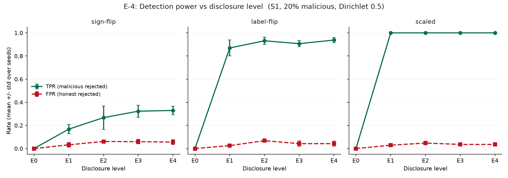
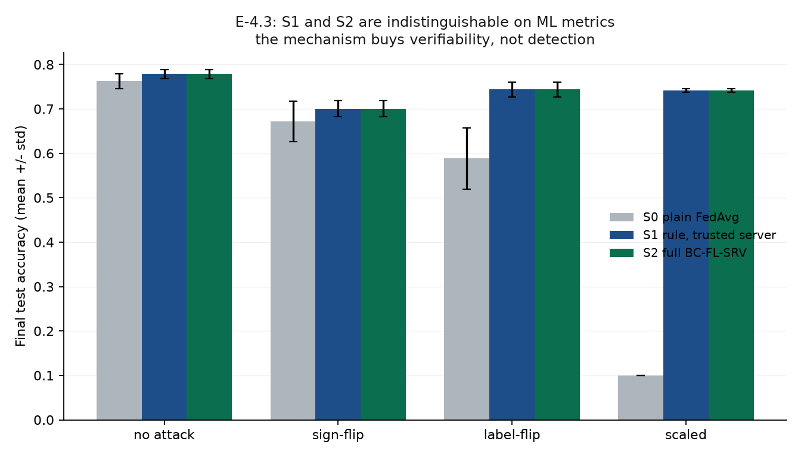
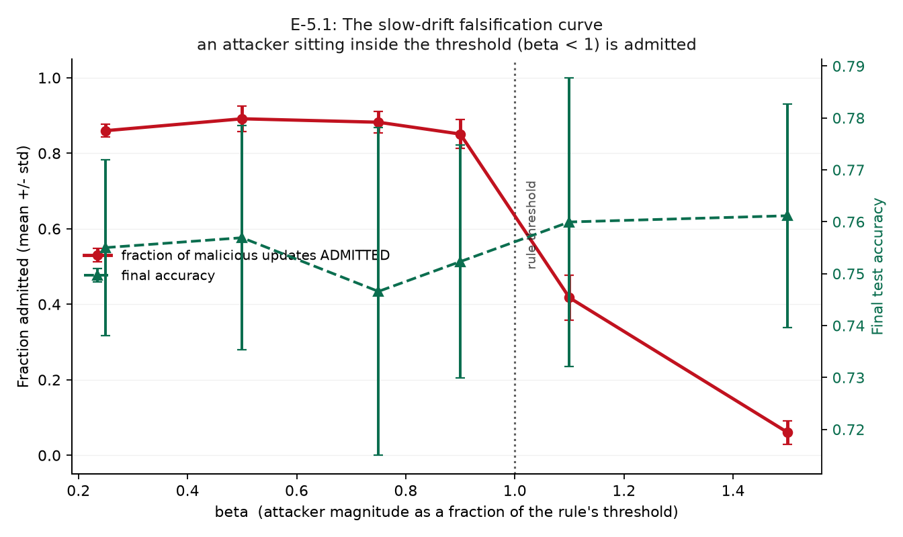
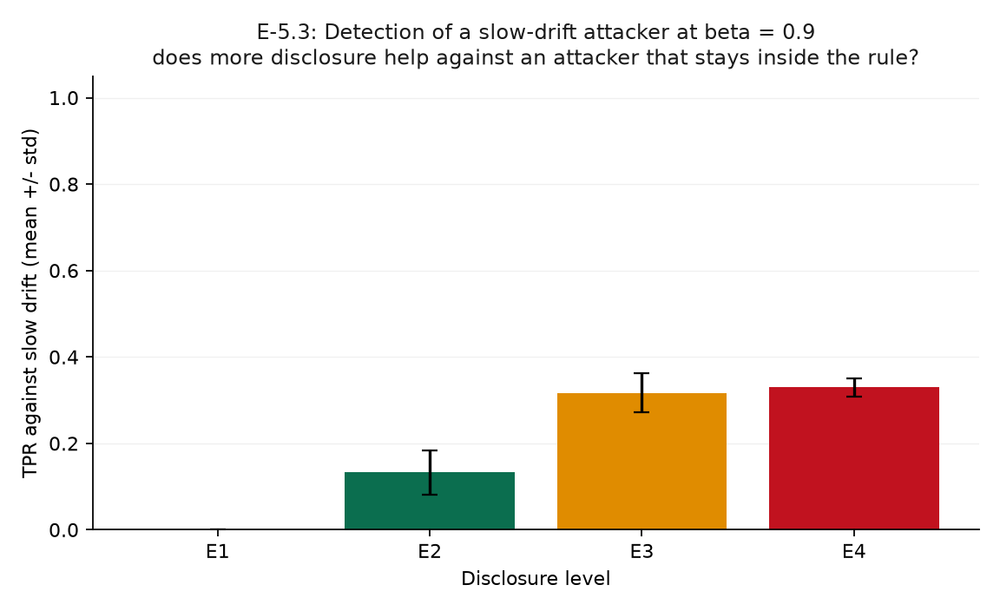

# E-4 / E-5 Findings — Does the Mechanism Provide Useful Security?

**Experiments:** E-4, E-5 (`scripts/exp_e4_e5.py`, `scripts/plot_e4_e5.py`)
**Tests:** **C4** (more disclosure buys more detection) and **C5** (verifiable admission stops a slow-drift attacker)
**Date:** 2026-09-04 · 159 runs, 69.6 min on 12 CPU cores · Fashion-MNIST, Dirichlet α=0.5, 30 clients, 10/round, 25 rounds
**Reproduce:** `.venv/Scripts/python.exe scripts/exp_e4_e5.py --workers 3` then `scripts/plot_e4_e5.py`

Status tags: `LIT` literature · `HYP` hypothesis · `IMPL` implemented · `RESULT` measured.

> **Headline: C5 is FALSE, exactly as pre-registered.** A slow-drift attacker calibrated to sit inside the admission threshold is admitted **85–89% of the time**. No disclosure level stops it. This was predicted before the experiment ran (P4) and the attacker was never weakened.
>
> **Second headline, unexpected: evasion is not the same as damage.** The attacker gets in, but at 20% malicious it costs only ~3 accuracy points. The interesting failure is elsewhere — see §5.

---

## 1. Provenance caveat, stated plainly

The run manifest records **`git_dirty: true`**. The experiment code (`scripts/exp_e4_e5.py`, commit `d4a00d4`) and the entire `src/` package were committed at launch; the uncommitted files were `README.md` and `scripts/plot_e4_e5.py`, neither of which the experiment imports. The results are therefore reproducible from `d4a00d4`, but the manifest flag is reported rather than suppressed.

---

## 2. E-4: does more disclosure buy more detection? `RESULT`

TPR / FPR / final accuracy, S1, 20% malicious, mean ± std over 3 seeds:

| Level | Committee sees | no attack FPR | sign-flip TPR | label-flip TPR | scaled TPR |
|---|---|---|---|---|---|
| **E0** | commitment only | 0.00 | 0.00 | 0.00 | 0.00 |
| **E1** | norm (1 scalar) | 0.06 | 0.17 ± 0.04 | **0.87 ± 0.07** | **1.00 ± 0.00** |
| **E2** | + cosine | 0.07 | 0.27 ± 0.10 | 0.93 ± 0.03 | 1.00 ± 0.00 |
| **E3** | 64-dim sketch | 0.09 | 0.32 ± 0.05 | 0.91 ± 0.03 | 1.00 ± 0.00 |
| **E4** | full plaintext | 0.09 | 0.33 ± 0.04 | 0.94 ± 0.02 | 1.00 ± 0.00 |

### 2.1 The rule matters enormously — for crude attacks

At **E0** (no rule at all), the scaled attack drives accuracy to **0.100 ± 0.000 — exactly random guessing on 10 classes.** The model is destroyed. At E1 and above it recovers to ~0.76. A single disclosed scalar is the difference between a working model and a dead one.

### 2.2 …but the ladder buys surprisingly little above E1

**E1 discloses one number per client. E4 discloses the entire update — total privacy loss.** The detection difference:

| Attack | E1 | E4 | Gain from full disclosure |
|---|---|---|---|
| scaled | 1.00 | 1.00 | **none** |
| label-flip | 0.87 | 0.94 | +0.07 |
| sign-flip | 0.17 | 0.33 | +0.16, and still poor |

Meanwhile **FPR rises from 0.06 to 0.09** — full disclosure rejects *more* honest clients.

**C4 is weakly supported at best.** Detection does increase monotonically with disclosure, so the ladder is real, but the marginal gain from surrendering all privacy is small. **For this rule set, most of the value is available at the cheapest, most private rung.**

That is a genuinely favourable result for the privacy story, and it was not the predicted one.

### 2.3 Two pre-registered predictions were WRONG

Recorded because pre-registration is only worth something if failures are reported.

| Prediction | Outcome |
|---|---|
| **P2** — "A3 caught at E1+; A1 caught at E2+" | **Half wrong.** A3 caught perfectly at E1 (1.00). **A1 sign-flip never caught well** — 0.33 even at full disclosure. |
| **P3** — "A2 poorly caught at E1, better at E3/E4" | **Wrong.** Label-flip is caught 0.87 at E1 and only 0.94 at E4. |
| **P5** — "FPR rises with disclosure" | **Correct.** 0.00 → 0.06 → 0.07 → 0.09 → 0.09. |

**Why sign-flip evades:** it submits `−u`, which has *exactly the same norm* as an honest update, so the norm rule is blind to it by construction. Under non-IID data with α=0.5, honest updates already point in widely varying directions, so a reversed update is not a clear outlier either. This is a limitation of the *rule*, not of the mechanism.

### 2.4 S1 ≡ S2, to machine precision `RESULT`

| Attack | S1 accuracy | S2 accuracy | Difference | S1 TPR | S2 TPR |
|---|---|---|---|---|---|
| no attack | 0.7785 | 0.7785 | **0.00e+00** | — | — |
| sign-flip | 0.7005 | 0.7005 | **0.00e+00** | 0.267 | 0.267 |
| label-flip | 0.7436 | 0.7436 | **0.00e+00** | 0.931 | 0.931 |
| scaled | 0.7415 | 0.7415 | **0.00e+00** | 1.000 | 1.000 |

Prediction **P1 confirmed exactly.** The only difference is **51,215 bytes of transcript** over 25 rounds (~2 KB/round).

**This is the single most important result in the project.** It is the precise statement of what BC-FL-SRV contributes: *verifiability at ~2 KB/round, with zero effect on model outcomes.* Any accountability layer claiming to improve robustness should be asked to show this comparison — if S1 and S2 differ, the mechanism is doing something other than what it says.

---

## 3. E-5: the falsification curve `RESULT`

Slow-drift attacker at E2, 20% malicious, mean ± std over 5 seeds:

| β (magnitude ÷ threshold) | malicious **admitted** | TPR | final accuracy |
|---|---|---|---|
| 0.25 | **0.86 ± 0.02** | 0.14 | 0.755 ± 0.017 |
| 0.50 | **0.89 ± 0.03** | 0.11 | 0.757 ± 0.022 |
| 0.75 | **0.88 ± 0.03** | 0.12 | 0.747 ± 0.032 |
| 0.90 | **0.85 ± 0.04** | 0.15 | 0.752 ± 0.022 |
| **1.10** | 0.42 ± 0.06 | 0.58 | 0.760 ± 0.028 |
| **1.50** | 0.06 ± 0.03 | 0.94 | 0.761 ± 0.021 |

**The threshold behaves exactly as designed, which is precisely the problem.** An attacker above it is caught (94% at β=1.5). An attacker who simply *chooses* to sit below it is admitted ~87% of the time. Since the attacker knows the rule — the correct assumption for a security evaluation — it will always choose β < 1.

### 3.1 No disclosure level stops it

| Level | TPR vs slow drift (β=0.9) | admitted |
|---|---|---|
| E1 norm | **0.00 ± 0.00** | 1.00 |
| E2 + cosine | 0.15 ± 0.04 | 0.85 |
| E3 sketch | 0.32 ± 0.05 | 0.68 |
| E4 full plaintext | 0.33 ± 0.02 | 0.67 |

E1 detects **nothing** — unsurprising, since the attacker is calibrated against exactly that threshold. Even full plaintext disclosure catches only one third.

**C5 is FALSE.** `RESULT`

---

## 4. But evasion is not damage — the unexpected nuance

At 20% malicious, accuracy under slow drift is **0.747–0.761** across every β, versus **0.779** clean. The attacker is admitted 87% of the time and achieves roughly **3 accuracy points** of damage.

The reason is structural: to stay under the norm threshold the attacker must **shrink its own update**. Evasion and impact trade off directly — the constraint that makes it invisible also makes it weak. That trade-off is visible in the flat accuracy line of the figure and was not something we predicted.

**This tempers the headline without rescuing it.** The mechanism does not detect the attacker, but at realistic malicious fractions `LIT` (Shejwalkar et al., S&P 2022, argue high fractions are unrealistic in production) the attacker also does not achieve much.

---

## 5. The finding that concerns me most: the rule can be net harmful

E-5.2, slow drift at β=0.9, comparing **no rule** against **the rule**:

| Malicious fraction | S0 (no rule) accuracy | S1 (rule) accuracy | Rule helps? |
|---|---|---|---|
| 0.1 | 0.754 ± 0.018 | 0.761 ± 0.013 | marginally |
| 0.2 | 0.747 ± 0.022 | 0.752 ± 0.022 | marginally |
| **0.3** | **0.683 ± 0.024** | **0.617 ± 0.122** | **no — worse** |

At 30% malicious the admission rule leaves the model **worse than having no rule at all.** The mechanism admits 95% of the malicious updates anyway (they are calibrated to pass) while its false-positive rate keeps rejecting *honest* clients. It discards good updates and keeps bad ones.

The variance is large (±0.122 vs ±0.024), so this is **a directional finding at 3 seeds, not a precise measurement** — but the direction is consistent and the mechanism is clear. It deserves to be in the write-up, not smoothed away.

---

## 6. What this means for the research story

| Sub-claim | Verdict | Basis |
|---|---|---|
| **C1** tampering detectable | supported | E-2: 12/14, 0 false positives |
| **C2** cost independent of N | supported | E-1: 1.03× time for 65,536× payload |
| **C3** soundness degrades predictably | supported under stated assumptions | E-3: 30/30 within 3σ; grinding found and mitigated |
| **C4** disclosure buys detection | **weakly supported** | monotonic but small gains above E1, at rising FPR |
| **C5** stops slow drift | **FALSE** | 85–89% admitted at β<1; no level exceeds TPR 0.33 |

**The honest conclusion, in one sentence:**

> BC-FL-SRV provides **cheap, verifiable, quantifiably sound accountability for admission decisions** — and it faithfully records decisions made by a rule that a patient, rule-aware attacker walks straight through.

That is a real contribution and a real limitation, and they are separable. The accountability layer does what it claims: an outsider can verify *which clients were admitted and that the declared rule was applied*, at ~2 KB per round and microseconds per check, with soundness that degrades predictably in committee corruption. What it cannot do is make a weak rule strong. **AG1 attests that a rule was applied; it says nothing about whether the rule was worth applying.** Our experiments now demonstrate both halves of that sentence rather than asserting them.

---

## 7. What this does NOT demonstrate

1. **Fashion-MNIST is a controlled environment, not evidence about production FL.** One dataset, one architecture, one α, 30 clients — cross-silo scale at best.
2. **The rule set is deliberately simple.** These are ordinary norm/cosine/distance rules, not state-of-the-art robust aggregation. A stronger rule (FLTrust, centred clipping, or a cross-round history rule) might well catch slow drift. **We did not test that** — see §8.
3. **3 seeds for sweeps, 5 for the falsification curve.** The 30%-malicious result in §5 in particular has wide error bars.
4. **Simulation in one process.** No network adversary, no client churn beyond sampling, no timing attacks.
5. **The attacker has oracle knowledge of the threshold.** Conservative for us, but a real attacker would have to estimate it, and estimation error would raise its detection rate somewhat.
6. **Masking is simplified additive masking** providing statistical, not information-theoretic, hiding — and it does not affect any number here.

---

## 8. The obvious next question, deliberately not answered yet

`LIT` The literature's answer to slow drift is **cross-round** detection — FLDetector (KDD 2022), FLANDERS, ClusterGuard — which tracks each client's *history* rather than judging each round in isolation. An attacker that looks normal every round can still look abnormal *consistently*.

Framing F1 was killed early precisely because that space is well occupied, so implementing it would be an **engineering response to our own finding, not a novelty claim**. It is registered as **E5.5** in `E4_E5_MATRIX.md` and, if run, will be reported as a clearly-labelled separate iteration with §3's results left exactly as measured.

**It also runs straight into this project's own central tension:** cross-round detection requires per-client history, which is what secure aggregation exists to destroy. That is the same wall the whole field hits, and finding it independently from this direction is itself a result.
